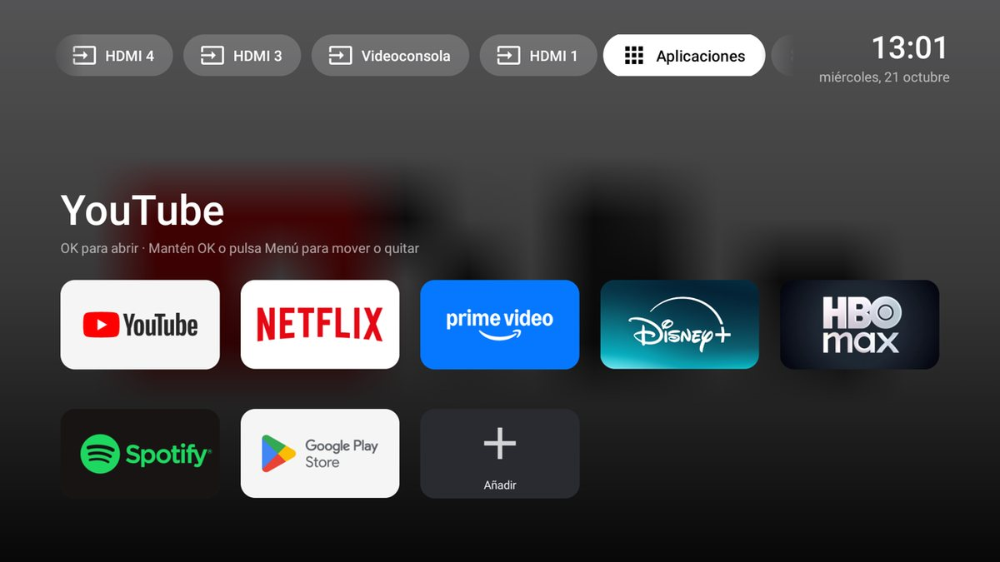
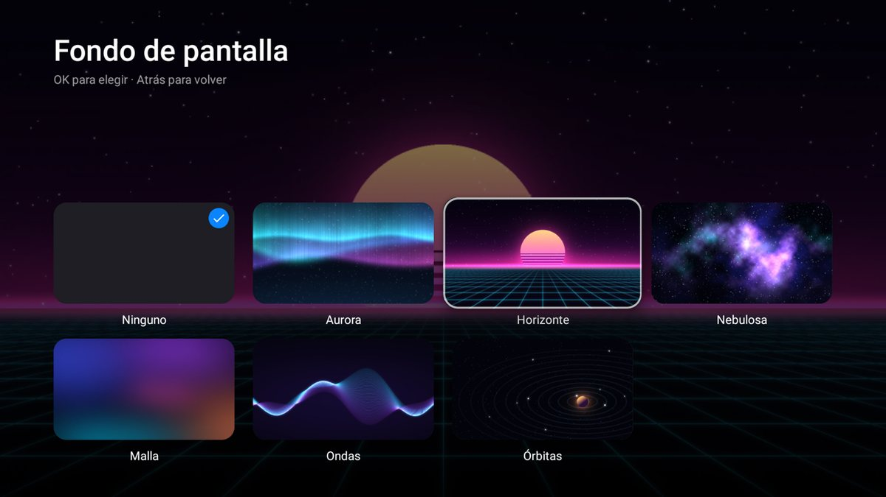
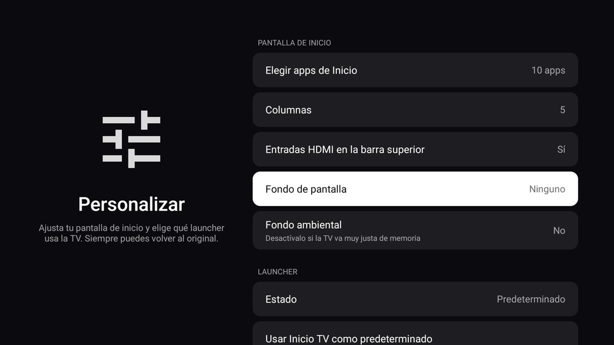
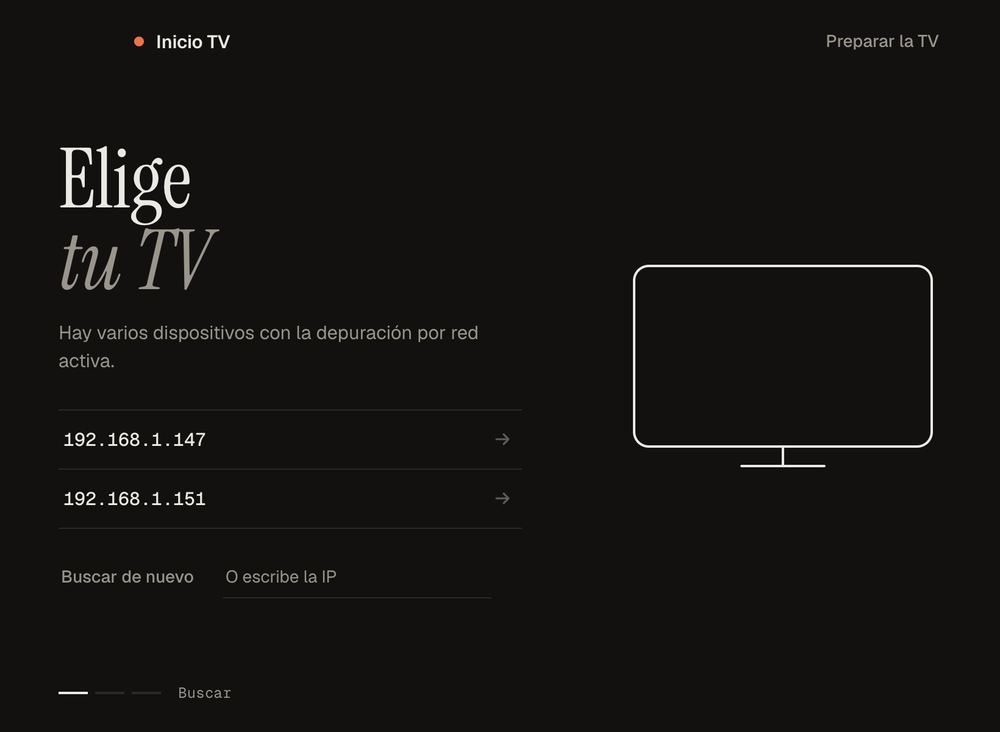
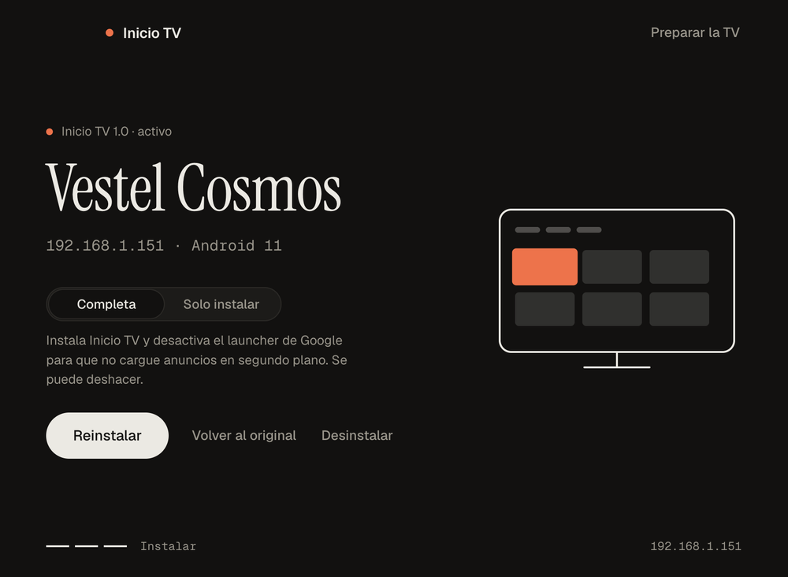
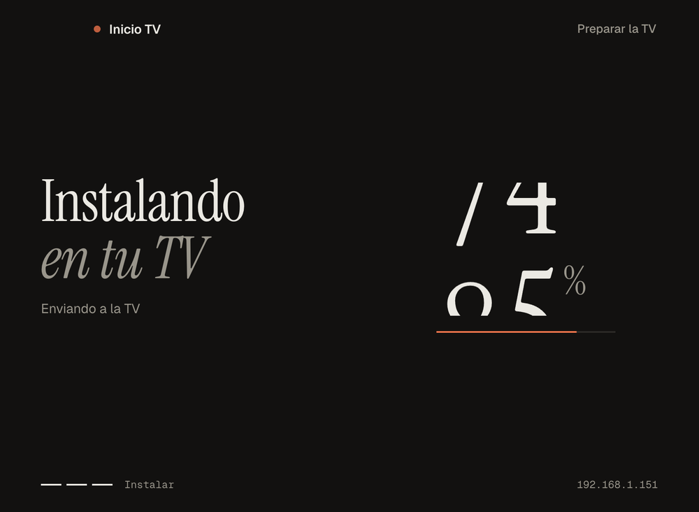
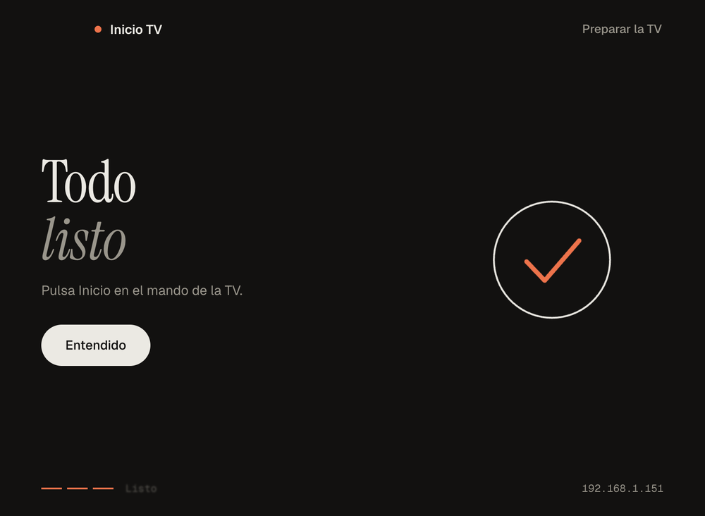

# Inicio TV

Un launcher ligero para Android TV, con estilo Apple TV, **sin anuncios ni recomendaciones** y sin servicios en segundo plano. Pensado para televisores que se han quedado lentos: el APK pesa unos 540 KB y no hace conexiones a internet.

Incluye un **instalador para Mac y Windows**: lo abres, encuentra tu TV por wifi y la instala en un par de clics. Y puedes **volver al launcher original cuando quieras**.



## Qué hace

- **Tus apps, tus reglas.** Eliges qué apps salen en Inicio, de entre las que tienes instaladas, y en qué orden.
- **Accesos rápidos arriba.** Entradas HDMI (con los nombres que les hayas puesto), TV, Aplicaciones, Ajustes de la TV, Red y Personalizar.
- **Rápido.** Sin Compose ni librerías pesadas, sin red y con los iconos en caché: volver a Inicio es instantáneo.
- **Fondos de pantalla.** Seis fondos incluidos (Aurora, Horizonte, Nebulosa, Malla, Ondas y Órbitas) y un fondo ambiental que toma el color de la app seleccionada.
- **Reversible.** Un botón dentro de la app, o un clic en el instalador, devuelve la TV a su launcher de fábrica.

| Fondos de pantalla | Personalizar |
| --- | --- |
|  |  |

## Compatibilidad

- **Android TV 7.0 o superior** (API 24). El launcher es una app Android normal.
- **Probado en:** una Hitachi (fabricada por Vestel) con Android 11. En otros modelos debería funcionar, pero no lo he podido comprobar: si lo pruebas, cuéntame el resultado en [Issues](../../issues).
- **Instalador:** macOS (Apple Silicon e Intel) y Windows 10/11. Hace falta que el ordenador y la TV estén **en la misma red**.
- **No es** para Fire TV, Apple TV ni móviles.

---

# Manual de instalación

La instalación tiene tres partes, y las dos primeras se hacen una sola vez:

1. [Descargar el instalador](#1-descargar-el-instalador)
2. [Preparar la TV](#2-preparar-la-tv-una-vez)
3. [Instalar Inicio TV](#3-instalar-inicio-tv)

## 1. Descargar el instalador

Ve a **[Releases](../../releases/latest)** y descarga el archivo de tu sistema:

| Tu ordenador | Archivo |
| --- | --- |
| Mac con chip Apple (M1, M2, M3…) | `Instalador-Inicio-TV-…-Mac-arm64.zip` |
| Mac con procesador Intel | `Instalador-Inicio-TV-…-Mac-x64.zip` |
| Windows 10 u 11 | `Instalador-Inicio-TV-…-Windows.zip` |

*¿No sabes qué Mac tienes?* Menú Apple → **Acerca de este Mac**. Si dice «Chip», es Apple; si dice «Procesador Intel», es Intel.

Descomprime el archivo y abre el programa:

- **Mac:** abre **Instalador Inicio TV**. La primera vez, macOS puede decir que no puede verificarlo (la app no está firmada con un certificado de pago). Pulsa **clic derecho → Abrir → Abrir**. Si dice que está «dañada», abre la Terminal y ejecuta:
  ```bash
  xattr -cr "/ruta/a/Instalador Inicio TV.app"
  ```
  (puedes arrastrar la app a la Terminal para que escriba la ruta).
- **Windows:** abre **Instalador Inicio TV.exe**. Si aparece el aviso azul de SmartScreen, pulsa **Más información → Ejecutar de todas formas**.

> No necesitas instalar nada más: ni `adb`, ni Android Studio, ni cables.

## 2. Preparar la TV (una vez)

Para poder instalar apps desde el ordenador, hay que activar el **modo desarrollador** y la **depuración por red** en la TV. No cuesta nada ni invalida la garantía, y la TV sigue funcionando igual. Hazlo con el mando:

1. Abre **Ajustes** (la rueda dentada, en la pantalla de inicio de la TV).
2. Entra en **Preferencias del dispositivo → Información**. En algunas TV se llama *Sistema → Acerca de*.
3. Baja hasta **Compilación** (a veces «Número de compilación») y pulsa **OK 7 veces seguidas**. Saldrá el aviso *«Ahora eres desarrollador»*.
4. Vuelve atrás: dentro de *Preferencias del dispositivo* ha aparecido **Opciones para desarrolladores**. Entra.
5. Activa **Depuración USB** y **Depuración por red** (también puede llamarse *Depuración ADB por red* o *ADB por red*).
6. Deja la TV **encendida** y conectada a la misma red que tu ordenador.

El propio instalador tiene esta misma guía, con casillas para ir marcando, en el botón **Preparar la TV**.

## 3. Instalar Inicio TV

1. **Abre el instalador.** Busca tu TV solo (tarda un par de segundos).

   

   - Si encuentra **una sola TV**, se conecta directamente.
   - Si encuentra **varias**, elige la tuya. Si no sabes cuál es, la IP de la TV está en *Ajustes → Red e Internet*. También puedes escribirla tú.
   - Si **no encuentra ninguna**, te lo dice y te abre la guía del paso 2.

2. **Autoriza al ordenador (solo la primera vez).** La TV mostrará *«¿Permitir depuración?»*. Marca **«Permitir siempre desde este ordenador»** y pulsa **Permitir**. El instalador te muestra una animación de lo que verás en la pantalla.

3. **Elige el tipo de instalación y pulsa Instalar.**

   

   | Modo | Qué hace |
   | --- | --- |
   | **Completa** *(recomendada)* | Instala Inicio TV **y desactiva el launcher de Google**, para que deje de ejecutarse y de cargar anuncios en segundo plano. Es donde más se nota la mejora de velocidad. Se puede deshacer en cualquier momento. |
   | **Solo instalar** | Solo instala Inicio TV. En muchas TV, el launcher de Google conserva la prioridad y sigue abriéndose al pulsar Inicio. |

4. **Espera unos segundos** a que termine.

   

5. **Listo.** Pulsa el botón **Inicio** del mando de la TV: se abre Inicio TV.

   

---

# Manual de uso

## Con el mando

| Quieres… | Haz esto |
| --- | --- |
| Abrir una app | Selecciónala y pulsa **OK** |
| Ir a una entrada HDMI o al sintonizador | Elige su botón en la barra de arriba |
| Mover o quitar una app de Inicio | **Mantén OK** (o pulsa **Menú**) sobre ella → *Mover* o *Quitar de Inicio* |
| Colocar una app que estás moviendo | Flechas para moverla y **OK** para terminar |
| Añadir apps a Inicio | Tarjeta **＋ Añadir** al final de la cuadrícula |
| Volver a la primera app | Pulsa **Inicio** o **Atrás** |

## Personalizar

Abre **Personalizar** desde la barra de arriba:

- **Elegir apps de Inicio:** marca o desmarca las apps que quieres ver.
- **Columnas:** 4, 5 o 6.
- **Entradas HDMI en la barra superior:** muéstralas u ocúltalas.
- **Fondo de pantalla:** elige uno de los seis. Al pasar por encima se ve a pantalla completa.
- **Fondo ambiental:** el color de la app seleccionada tiñe el fondo. Desactívalo si tu TV va muy justa de memoria.

Los nombres de las entradas HDMI son los que tengas puestos en los ajustes de la TV (por ejemplo «Videoconsola»).

## Volver al launcher original

Puedes hacerlo de tres maneras, sin perder nada:

1. **Desde la propia TV:** *Personalizar → Volver al launcher original*. Para volver a Inicio TV, abre «Inicio TV» desde *Aplicaciones* y elige *Personalizar → Usar Inicio TV como predeterminado*.
2. **Desde el instalador:** conéctate a la TV y pulsa **Volver al original**. Con **Desinstalar** además se elimina Inicio TV.
3. **Con la línea de comandos:** `./scripts/revertir.sh <IP-de-la-TV>` (ver más abajo).

> Los botones de la propia TV usan la depuración por red de la TV (la que activaste en el paso 2). Si la desactivas, esos botones no podrán cambiar de launcher, y tendrás que usar el instalador o los scripts.

---

# Problemas frecuentes

**El instalador no encuentra mi TV.**
Comprueba que la TV está encendida, que la *Depuración por red* sigue activada (algunas TV la apagan al reiniciarse) y que el ordenador está en la **misma red** (no en el wifi de invitados). Si tu router aísla los dispositivos entre sí, no se verán. Como alternativa, escribe la IP de la TV a mano.

**No aparece «Depuración por red» en Opciones para desarrolladores.**
En algunas TV solo aparece con la *Depuración USB* activada. Actívala, sal de las opciones y vuelve a entrar. Si sigue sin aparecer, tu TV puede no soportar depuración por red.

**La TV no muestra el aviso «¿Permitir depuración?».**
Comprueba que no hay una autorización antigua: en *Opciones para desarrolladores* hay una opción **Revocar autorizaciones de depuración USB**. Úsala y vuelve a intentarlo. Mira la pantalla de la TV: el aviso solo sale unos segundos si no hay nada más en primer plano.

**Instalé en modo «Solo instalar» y al pulsar Inicio sigue saliendo el launcher de Google.**
Es lo esperado en muchas TV. Vuelve a ejecutar el instalador en modo **Completa**.

**Quiero deshacerlo todo.**
Instalador → **Volver y desinstalar Inicio TV**. La TV queda como estaba.

**«El archivo está dañado» (Mac) o aviso de SmartScreen (Windows).**
Ver el [paso 1](#1-descargar-el-instalador). Las apps no están firmadas porque los certificados de firma son de pago.

---

# Seguridad y privacidad

- **Sin anuncios, sin telemetría y sin cuentas.** Inicio TV no envía nada a ningún servidor.
- **Permiso de internet:** la app lo declara, pero solo lo usa para hablar con la propia TV (`127.0.0.1`) cuando cambias de launcher desde la TV.
- **Depuración por red:** al activarla, cualquier ordenador de tu red local *autorizado por ti* podría instalar apps en la TV. La TV pide permiso la primera vez para cada ordenador. Si no la necesitas más, puedes desactivarla después de instalar.
- **Qué hace el modo «Completa»:** ejecuta `pm disable-user` sobre el launcher de Google (`com.google.android.tvlauncher` y similares). No borra nada, y el instalador lo reactiva con «Volver al original».
- **Qué hace el instalador:** solo habla con la IP que eliges, y solo escanea redes privadas (192.168.x.x, 10.x.x.x, 172.16-31.x.x). No funciona por internet con una IP pública, y no debería.
- **El APK está firmado con una clave de depuración**, pensada para uso personal. Si lo compilas tú, tendrás que desinstalar el anterior antes de instalar el tuyo.

---

# Para usuarios avanzados

## Línea de comandos

Con [`adb`](https://developer.android.com/tools/releases/platform-tools) instalado, y la TV preparada como en el paso 2:

```bash
./scripts/instalar.sh 192.168.1.50            # instala y activa
./scripts/instalar.sh 192.168.1.50 --fuerte   # además desactiva el launcher de Google
./scripts/revertir.sh 192.168.1.50            # vuelve al original
./scripts/revertir.sh 192.168.1.50 --desinstalar
```

## Compilar el launcher

Necesitas JDK 17 y el Android SDK (API 35):

```bash
./gradlew assembleRelease
```

El APK queda en `app/build/outputs/apk/release/app-release.apk`. Para que lo incluya el instalador, cópialo a `instalador/resources/inicio-tv.apk`.

## Compilar el instalador

Necesitas Node 20 o superior:

```bash
cd instalador
npm install
npm start        # abre la app
npm test         # pruebas
npm run dist     # genera los instaladores en instalador/dist/
```

## Publicar una versión

Los instaladores los compila GitHub Actions al crear una etiqueta de versión:

```bash
git tag v1.0.1
git push origin v1.0.1
```

En unos minutos aparece una *Release* con los archivos de Mac y Windows (ver `.github/workflows/release.yml`).

## Estructura del repositorio

| Carpeta | Contenido |
| --- | --- |
| `app/` | El launcher (Kotlin, vistas nativas, solo RecyclerView como dependencia) |
| `instalador/` | La app de escritorio (Electron) con su propio cliente ADB |
| `scripts/` | `instalar.sh` y `revertir.sh` para la línea de comandos |
| `tools/` | `wallpapers.py`, que genera los fondos de pantalla |
| `docs/img/` | Capturas de este manual |

## Créditos

Tipografías del instalador: [Instrument Serif](https://fonts.google.com/specimen/Instrument+Serif) y [Geist](https://vercel.com/font), ambas con licencia SIL Open Font License (ver `instalador/src/ui/fonts/`).

*Inicio TV no está afiliado ni respaldado por Google, Apple ni Hitachi. Android TV es una marca de Google LLC.*
